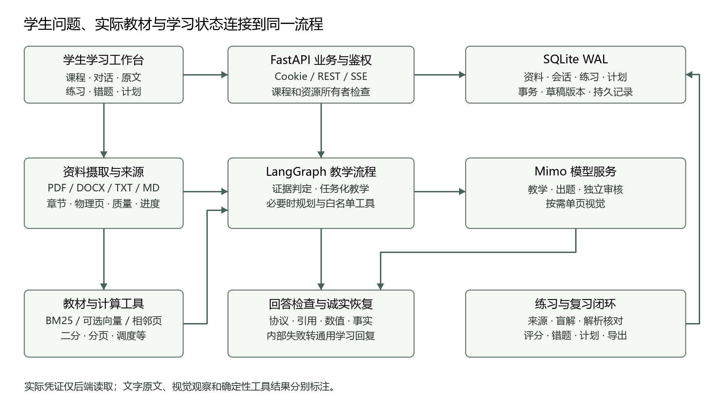
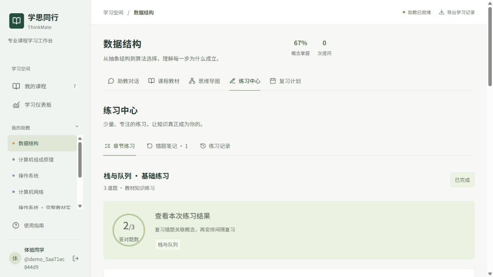
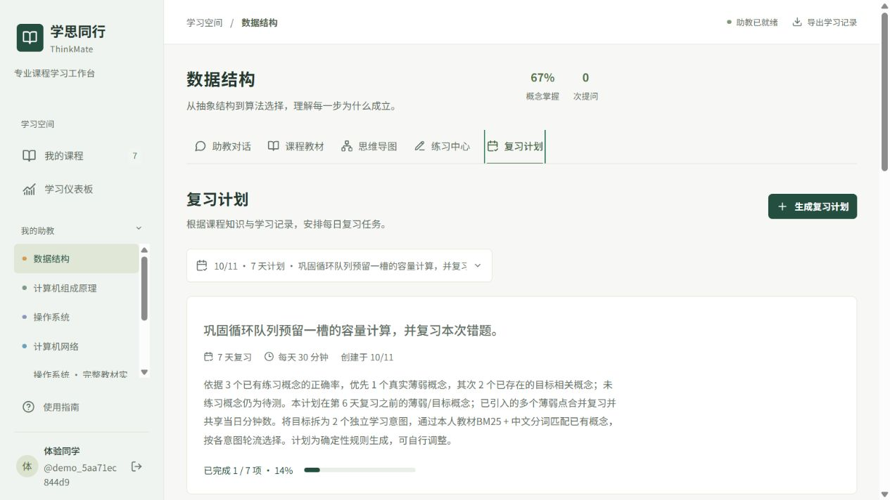

# 学思同行项目技术与验收报告

专业课助教智能体　中兴赛道命题二

交付版本：2026年10月11日

学思同行面向正在学习专业课的学生，将教材、提问、计算验证、练习和复习记录连接到一个学习工作台。学生可使用内置四门 408 参考课，也可上传有权使用的资料建立自己的课程。当前在线教学、出题、审核和视觉默认统一使用 mimo-v2.6-flash。

本报告前七章按比赛技术文档要求编排：系统架构图、模块说明、核心功能介绍、技术路线、部署方式、依赖环境和配置项说明。第八章附实际测试与验收证据。

## 1 系统架构图

### 1.1 组件与数据流

生产运行时，FastAPI 在同一端口提供 API 和已构建的前端页面。SQLite 保存账号、课程、会话、教材状态、练习、错题和计划；LangGraph 组织受限教学流程，Mimo 提供模型能力。语义向量服务可选，仓库配置示例仅用本地 BM25 检索。

### 1.2 一次学习请求的流程

- 学生选择自己的课程并提问，服务端先检查登录状态与资源归属，再读取当前教材和本会话历史。
- 基础问题已有充分正文时直接组织教学；复杂计算、代码、原图和实现边界按需执行白名单工具。
- 草稿经过协议、来源、数值和必要事实检查后才向学生展示并保存；内部失败进入诚实恢复路径。
- 学生继续作答或追问，沿当前步骤反馈；练习结果进入错题、薄弱点和阶段计划，刷新后仍可继续。

详细调用链见 docs/architecture.md。凭证仅由后端读取，不进入浏览器构建或公开配置接口。

## 2 模块说明

### 2.1 模块职责

| 模块 | 主要职责 |
| --- | --- |
| 学习界面 | 课程、对话、教材原文、引用、导图、练习、计划和学习仪表板 |
| 身份与数据 | 注册及随机演示账号、加盐密码散列、会话、逐资源所有权检查和持久保存 |
| 教材摄取 | PDF/DOCX/TXT/MD 解析、章节与物理页定位、质量提示、分块、进度及缺失向量续建 |
| 检索与证据 | BM25、可选 BGE-M3 与结果融合、目录/前言、相邻页和图题定位 |
| 教学与工具 | 讲解、启发、解题策略；有限规划、白名单工具、来源和事实检查 |
| 练习与复习 | 内置题库、自建教材出题、盲解和解析审核、草稿、幂等评分、错题、计划和导出 |
| 恢复与记录 | 内部失败后的通用学习回复、诚实状态提示、执行摘要、模型和实际用量记录 |

### 2.2 主要实现位置

| 实现位置 | 对应内容 |
| --- | --- |
| frontend/src/views/ | 课程学习页面及交互 |
| backend/app/main.py、auth.py、db.py | API、鉴权、事务和数据保存 |
| backend/app/ingestion.py、materials.py、retrieval.py | 摄取、教材访问和检索 |
| backend/app/agent.py、teaching_prompts.py、fact_review.py | 教学流程、提示词和回答复核 |
| backend/app/chat_recovery.py、socratic_reply.py | 回复恢复与启发模式的当前请求约束 |
| backend/app/practice.py、quiz_review.py、plan_goals.py | 练习、解析审核和复习计划 |
| backend/app/knowledge_map.py | 教材结构、节点和学习关联 |

LangGraph 实际注册 planner、tools、evidence_check、teaching 四个节点；草稿校验与有限重生成位于 teaching 内部。接口说明见 docs/api-contract.md。

## 3 核心功能介绍

### 3.1 课程与教材

内置数据结构、计算机组成原理、操作系统、计算机网络四门参考课，各有独立资料、题库和学习状态。用户自建课以本人上传教材为依据。资料支持 PDF、DOCX、TXT、MD；默认单文件上限 200 MiB，PDF 最多 2,000 页。

摄取进度和批次状态保存到数据库，中断后只续建缺失内容。解析质量不足时给出提示；扫描无文本文件需要先建立文字层，按需查看单页图片不能替代整书 OCR。

### 3.2 助教的三种模式

| 模式 | 学生看到的行为 | 基础质量要求 |
| --- | --- | --- |
| 讲解模式 | 直接解释当前概念，使用必要的例子 | 贴合问题；生活对象与概念对应一致；总览不重复展开 |
| 启发模式 | 给出有限情境，推进学生可回答的一步 | 不先泄题；先判断当前尝试；每轮只要求一个动作或判断 |
| 解题模式 | 说明条件、必要步骤、结果和关键理由 | 按当前参数核验计算；不附加未经执行的变体结论 |

学生明确要求直接讲解或“不要继续提问”时遵从当前请求；旧历史中的“这一次只问”不永久约束后续。多轮对话保留当前步骤，学生纠正后的新答案优先于历史误解。

### 3.3 原文引用与计算核对

回答可展开查看实际教材章节和原文。物理页、逻辑段、视觉观察和工具结果分别标注；引用必须绑定本次实际来源。

计算工具支持安全算术、二分查找轨迹、分页地址转换、调度、页面置换、银行家算法、子网、非负图最短路径和 Cache 等。学生可展开查看实际输入、步骤与结果。工具只核对所给条件，不把一个正确轨迹用于未执行的题目变体。

### 3.4 练习、错题与复习计划

自建教材出题先核对来源和概念，再独立盲解、审核解析，通过后保存。提交前不展示答案；草稿保存与正式评分分开，重复提交不会重复累计。

真实错误作答形成错题和薄弱点。计划优先采用实测薄弱点、已有目标与真实章节，支持勾选、刷新继续和导出。概念归属不唯一时不累计掌握度，归档错题不创造正确作答。

### 3.5 导图与持续学习记录

导图表达教材实际章节关系，支持搜索、分支、本人笔记、主动回忆和图题查看，并可导出图片。课程记录、已提交练习、错题和计划可导出；未提交的题目答案和他人资料不随导出泄露。

普通专业知识通用模型已经能够回答。项目的额外价值在于与当前教材对齐、针对学生本轮尝试反馈、按具体条件核对，以及持续保存学习进展。未开展豆包产品实测或学生成绩提升研究。

## 4 技术路线

### 4.1 教材检索与有限工具流程

上传资料解析为带章节、页码和来源身份的片段，首先执行本地 BM25 检索；需要语义向量时可接入独立 BGE-M3 服务并融合结果。整书概览优先目录和前言，图题按真实定位访问原页。

已有有效正文足够的基础任务省去额外工具规划。复杂任务默认最多 4 轮工具决策，每轮最多 6 项；文字来源最多 18 项，页图最多 2 页。工具集合不包含 Shell 或任意代码执行。

### 4.2 任务化提示与学生反馈

三种模式共享教材、历史与模型，但采用不同教学要求。单步启发以 feedback/question 结构输出：反馈最多 240 字、问题最多 140 字，简单判断优先控制在 80 字内。一个问号不能掩盖两个任务，生活类比只选择一个情境，概念端点对应唯一位置。

提示词优先处理最新学生请求与尝试，区分真正的禁问指令、引用语句和假设表述。模型隐藏推理不向学生展示或保存。

### 4.3 回答与练习质量检查

教学先缓冲草稿，检查协议、引用、位置、隐藏内容、数值声明，并按需要进行独立事实审查。首次明确内容拒绝最多重生成一次。出题另有来源核对、盲解和解析审核，不能只凭模型表示“已批准”就认定题目正确。

当前审核通常与教学使用同一底模；自动检查用于减少已知错误，真实基础场景另按完整正文、实际原文和工具结果人工核验。

### 4.4 内部失败与回复恢复

检索、工具、格式或复核失败后，尝试一次隔离的通用模型回复。恢复不接收失败草稿、旧引用或内部错误，只解释通用概念与方法，并明确教材和工具尚未核实。判断以学生最后一次当前尝试为准。

教学执行按 PROVIDER_TIMEOUT_SECONDS 限时，默认 90 秒；恢复另最多 min(30 秒,该配置值)。期限约束模型工作，不包括排队和所有本地 I/O。仍不可用时提供诚实续接提示，与模型生成答案区分。额度不足、限流、用户取消和身份/请求合法性保留必要提示。

Mimo 用 thinking.type 显式启闭推理；特定 JSON 运输故障有界恢复，内容过滤、截断和无效协议仍拒绝。实际付费重试用量累计，输出预算不代表费用上限。

## 5 部署方式

### 5.1 交付形态与准备

本作品通过 GitHub 仓库 Learn-Think-Together 交付，根目录 README.md 为运行和材料入口。仓库包含 backend/、frontend/、content/、scripts/、Dockerfile、compose.yaml 和 docs/，包括前端源码、依赖锁文件、技术报告、用例、视频与合规说明。前端 dist 不上传，启动脚本按依赖锁文件安装并构建。可克隆到本机：

~~~sh
git clone https://github.com/yangbin13/Learn-Think-Together.git
cd Learn-Think-Together
~~~

接收方在仓库根目录配置自己的 .env，再按 README 安装或启动。本仓库不提供可用凭证、私人教材、原数据库或账号资料。

### 5.2 Windows 原生启动

在源码根目录执行：

~~~powershell
if (-not (Test-Path -LiteralPath '.env')) {
    Copy-Item -LiteralPath '.env.example' -Destination '.env'
}
~~~

编辑 .env，按第七章填写模型凭证，再启动：

~~~powershell
powershell -ExecutionPolicy Bypass -File scripts/start.ps1
~~~

默认访问 http://127.0.0.1:8765，点击“体验学习工作台”进入隔离随机演示账号，无需固定测试密码。依赖和构建已准备好时可加 -SkipInstall；选择空闲端口可加 -Port 8766。Ctrl+C 停止本脚本启动的进程。已有 .env 时保留现有文件，不再次执行复制。

### 5.3 Linux 原生启动

准备 Python、Node.js 和 npm，在源码根复制并编辑配置，然后运行：

~~~sh
test -f .env || cp .env.example .env
sh scripts/start.sh
~~~

脚本创建虚拟环境、按锁文件安装后端依赖、构建前端并启动 8765 服务。可用 PORT 指定空闲端口。该方式已提供脚本，最新封版未重新进行 Linux 运行验收。

### 5.4 Docker Compose 部署

准备 Docker Engine 或 Docker Desktop 及 Compose，在源码根完成 .env 配置后执行：

~~~sh
docker compose up --build -d
docker compose ps
docker compose down
~~~

Dockerfile 以 Node.js 22 构建前端，以 Python 3.12 构建后端运行环境；后端同端口提供页面和 API。Compose 默认绑定 127.0.0.1:8765，以 tutor-data 命名卷保存数据。

当前交付为从源码构建镜像的方式，没有预构建镜像文件。最新封版的 Docker 构建与启动未实测；已经完成的是 Windows 原生和独立解压项目的运行验收。

### 5.5 数据保存与配置生效

原生默认运行数据保存在 data/，不上传 GitHub。Docker 正常停止不加 -v，避免删除命名卷。修改 .env 后重启后端；进程环境变量优先于 .env。公网部署应采用 HTTPS，并单独配置备份、监控与容量方案。

## 6 依赖环境

### 6.1 当前实际验收环境

| 项目 | 当前版本或要求 |
| --- | --- |
| 操作系统 | Windows 11；当前原生验收环境 |
| Python | 3.12.3；Dockerfile 使用 Python 3.12 |
| Node.js / npm | Node.js 22.17.0、npm 10.9.2；用于依赖安装、构建和前端检查 |
| 前端构建 | TypeScript 与 Vite；本轮 Vite 6.4.3 构建通过 |
| 数据库 | SQLite，由 Python 使用；单实例运行，无需另装数据库服务 |
| 在线模型 | OpenAI 兼容接口；当前 mimo-v2.6-flash，需要自己的有效凭证 |
| 容器方式 | Docker Engine/Desktop 和 Compose；当前版本配置已提供、运行未实测 |

### 6.2 主要软件依赖

| 分层 | 主要依赖与用途 |
| --- | --- |
| Web 服务 | FastAPI、Uvicorn、python-multipart、HTTPX |
| 模型与流程 | OpenAI SDK、LangGraph |
| 检索 | jieba、rank-bm25、NumPy；可选独立向量服务 |
| 文档与页图 | pypdf、python-docx、pypdfium2、Pillow、fonttools |
| 前端 | React 19、TypeScript、Vite、React Flow、KaTeX、Markdown 组件 |
| 测试 | pytest 与 frontend/scripts/ 中的 Node.js 检查脚本 |

后端安装使用 backend/requirements.lock.txt，前端安装使用 frontend/package-lock.json。依赖许可保留在源码的许可目录；不要求学生另行安装 LangGraph 平台、向量数据库或 Redis。

### 6.3 网络与运行条件

首次安装及 Docker 构建需访问依赖仓库。在线 AI 需能够访问所配置的模型服务；未配置凭证时可浏览内置资料、使用内置题库和已有学习记录，在线生成能力不可用。启用向量服务需另有可用接口，关闭时使用 BM25。公开演示截图使用原创资料，不依赖私人教材。

## 7 配置项说明

### 7.1 普通 MiMo 用户的最小配置

复制 .env.example 为 .env 后，启用在线 AI 必须填写自己的 LLM_API_KEY。默认服务地址与模型已经填写；使用普通 MiMo 接口时主要补凭证，使用 Token Plan 或其他兼容服务时按所购套餐核对地址和模型名称。

| 配置项 | 默认示例与填写要求 |
| --- | --- |
| LLM_API_BASE | https://api.xiaomimimo.com/v1；Token Plan 用户改为自己套餐提供的接口地址 |
| LLM_MODEL | mimo-v2.6-flash；确认自己的账号和接口支持该模型 |
| LLM_API_KEY | 示例为空；在线 AI 必填自己的服务端凭证，报告与仓库不包含可用值 |

仓库 .env.example 设置 EMBEDDING_ENABLED=false，采用 BM25；只填写一份 MiMo 凭证即可使用该配置的检索与教学。无需为教学、出题、审核和视觉分别配置四份凭证。

### 7.2 可选模型与向量配置

| 配置项 | 用途及默认行为 |
| --- | --- |
| LLM_QUIZ_MODEL | 留空复用主模型；内置 408 题库不调用出题模型 |
| LLM_REVIEW_MODEL | 留空复用主模型；需要不同审核模型时才填写 |
| VISION_MODEL / VISION_ENABLED | 模型名留空复用主模型；视觉默认启用，兼容服务须支持图片输入 |
| LLM_QUIZ_THINKING / LLM_REVIEW_THINKING | 默认 false，按服务接口显式启闭出题和审核推理 |
| LLM_QUIZ_THINKING_BUDGET / LLM_REVIEW_THINKING_BUDGET | 默认 1024，整数 128–32768；仅相应推理启用时采用 |
| LLM_JSON_MODE_ENABLED | 默认 true；服务不支持 response_format 时可关闭，返回仍严格校验 |
| EMBEDDING_ENABLED / EMBEDDING_MODEL | 仓库示例为 false；需要语义向量时启用，模型示例 BAAI/bge-m3 |
| EMBEDDING_API_BASE / EMBEDDING_API_KEY | 独立向量服务地址与凭证，必须同时填写；MiMo 凭证不等于 BGE-M3 接口凭证 |

### 7.3 运行与资源配置

| 配置项 | 说明 |
| --- | --- |
| TUTOR_DATA_DIR | 原生默认 data，保存运行文件和数据库；Compose 固定为 /app/data |
| TUTOR_DATABASE | 可选独立数据库路径；默认使用数据目录内 tutor.sqlite3 |
| MAX_UPLOAD_MB | 默认 200 MiB，整数 1–512，修改后重启 |
| COOKIE_SECURE | 本机 HTTP 默认 false；正式 HTTPS 部署设 true |
| PROVIDER_TIMEOUT_SECONDS | 上游与教学执行期限，默认 90 秒；恢复另有最多 30 秒期限 |
| LLM_MIN_OUTPUT_TOKENS | 默认 0，使用任务默认预算；整数 0–32768，不是费用上限 |

### 7.4 配置与凭证保护

.env 只由后端读取，不进入前端构建，已列入源码提交排除规则。.env.example 保留空凭证字段；文档、演示和测试公开摘要不含实际 key、Cookie、访问令牌或密码。更换底层模型后，应重启后端并重新检查基础教学行为。

## 8 测试与验收（附章）

### 8.1 当前冻结版本的自动检查与运行复现

本轮冻结业务代码完整后端回归 2276 项通过，0 失败/错误/跳过，pytest 命令用时 381.80 秒；前端 60 项检查及 TypeScript/Vite 构建通过。当前学生指令、单步、来源与恢复专项 486 项通过；超时、取消、恢复与导出专项 100 项通过。Windows PowerShell 5 启动、占用端口拒绝和只清理自有进程 10 项通过。

独立新数据目录、无模型凭证、BM25 的干净启动 29 项通过，覆盖实际 HTTP、文件/PDFium、草稿、计划、导出、权限和重启留存。同冻结应用源码的验证 ZIP 实际解压后，209 个应用、测试、前端源码和构建文件与当前内容一致；从解压项目另完成 29 项运行检查。两次均使用已安装依赖，并非重新联网安装或 GUI 验收。

机器记录见 docs/validation/release-verification-20261011.json；这些分组存在重叠，不累计为一个准确率。本次报告调整仅重排文档和校对证据，没有改动冻结业务代码，也没有再次运行完整业务测试。

### 8.2 真实 Mimo 三模式基础场景

| 场景 | 实际检查结果 |
| --- | --- |
| 整书核心知识总览 | 通过；540 字单表覆盖第 1–14 章，6 个实际结构来源 |
| 重点概念与生活例子 | 通过；317 字，数组位置与柜号、数据与物品一致，真实出处 |
| 递归新手单步 | 通过；70 字有限情境，不先定义，只问下一动作 |
| 学生递归尝试后继续 | 通过；先判断正确，只问末张动作，刷新文本一致 |
| 无序数组二分误解 | 通过；先纠错，再问一步，实际教材依据 |
| 学生回答先排序 | 通过；接着当前步骤问中间位置，不整段重讲 |
| 闭区间二分查找 10 | 通过；中点 3→5→4，下标 4、3 次比较，与实际工具卡一致 |
| 分页地址转换 | 通过；页号 2、偏移 452、物理地址 5572，工具与刷新一致 |

上述 8 项是正常教材教学路径，记录见 docs/validation/starter-prompts-20261011-results.json。最终演示另核验栈的生活类比、启发首轮、正确作答后的禁问请求、原失败历史的当前答案反馈和二分工具，5 条实际消息语义检查通过。其中原失败历史使用诚实通用恢复，不计为教材正常回答；二分回放的计算路径未受最后启发/类比修改影响，版本范围另有记录。

失败尝试保留为问题发现记录，不计入通过数。HTTP 成功、引用存在或模型审核批准，不能单独证明教学内容正确。通用直连 Mimo 在二分和分页对照中也能正确回答；本项目增加教材来源、确定性轨迹和连续学习记录，未据此宣称全面更快或知识回答更强。

### 8.3 真实教材练习闭环

隔离演示账号使用原创栈/队列讲义，实际 Mimo 出题和审核均为 mimo-v2.6-flash，27.86 秒生成一题。独立推演 D/E/F 出栈后入 G 的当前栈顶为 G，检查四个选项唯一性、解析和教材支持。

实际错误作答产生错题与薄弱点；重复提交不重复累计，7 天计划完成状态与导出读回一致。共 19 项内容与业务检查通过，见 docs/validation/mimo-release-learning-loop-20261011.json。本记录只覆盖这一次真实教材练习闭环。

### 8.4 正常、异常和边界用例

最终用例文件提供 32 条具体输入、预期、证据与边界，其中正常 17 条、异常 8 条、边界 7 条。各条均有已执行且通过的对应证据，满足比赛至少 10 条和三类覆盖要求；验证方式分别注明真实模型、真实 HTTP、受控自动或历史浏览器范围，并非 32 条全部以最终版本真实模型浏览器重跑。

用例包括三模式、多轮、答案隐藏、草稿/重复提交、计划、上传限制、取消/超时、越权、恢复、额度/限流、当前禁问请求与安全导出。具体结论见 docs/test-cases-final.md 与 docs/validation/test-case-coverage-20261011.json。

~~~powershell
.venv/Scripts/python.exe -m pytest backend/tests -q
cd frontend
npm test
npm run build
~~~

自动回归使用临时数据库与可控提供方，不修改原数据。真实模型样本不证明任意教材、任意题型或所有在线回答均正确。

### 8.5 实际学习界面

以下为真实浏览器操作画面，使用原创内置 408 资料。练习实际一错两对，计划完成一项且刷新后保留；不展示私人教材原页或凭证。

<!-- pagebreak -->

### 8.6 提交材料对应与边界

提交仓库：https://github.com/yangbin13/Learn-Think-Together。以下路径均相对于仓库根目录，评审可从 README.md 开始查看和复现。

| 比赛要求 | 仓库位置 |
| --- | --- |
| 可运行作品与演示模式 | backend/、frontend/、scripts/、Dockerfile、compose.yaml；根 README 提供启动和演示入口 |
| 技术文档 | docs/学思同行-项目技术与验收报告-20261011.docx 和同名 .pdf |
| README | README.md：材料入口、安装、配置、启动、测试与常见问题 |
| 至少 10 条用例 | docs/test-cases-final.md；对应验证记录在 docs/validation/ |
| 3–5 分钟演示 | docs/demo/学思同行-最终演示-20261011.mp4；附同名 .srt 与演示复现说明 |
| 合规说明 | docs/compliance.md：中文合规说明；原始许可见 docs/reference-licenses/ |

项目是本地可复现的单实例学习应用。最新封版 Linux/Docker 运行、整书 OCR、复杂图全部拓扑自动确认、大规模公共服务和真实学期成绩研究不在当前验收范围。数据来源及隐私细节见合规说明；比赛身份、报名和平台上传由参赛者办理。
